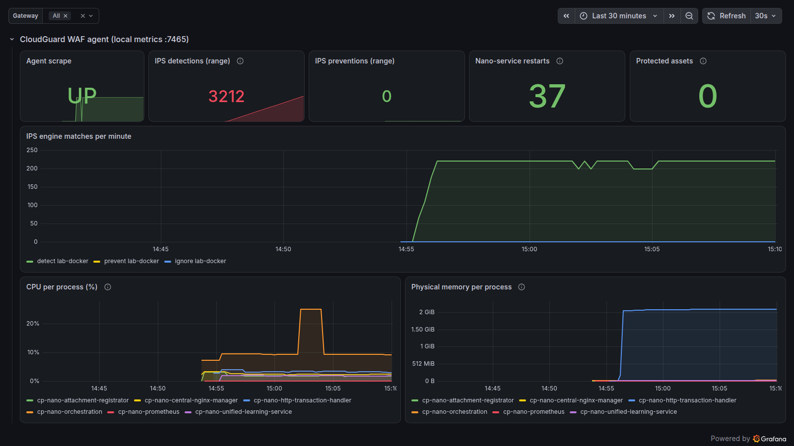

# CloudGuard WAF + Prometheus + Grafana

Step-by-step guide to monitor a **Check Point CloudGuard WAF** agent with **Prometheus** and **Grafana**. It covers a WAF deployed in **Docker** and a WAF deployed in **VMware** (CloudGuard WAF Gateway).



## How it works

```
 Users ──HTTPS──▶ CloudGuard WAF (VM or container) ──▶ Application
                    │
                    │  cp-nano-prometheus  →  GET http://<waf>:7465/metrics
                    ▼
               Prometheus (scrape every 15 s, alerts) ──PromQL──▶ Grafana

 Optional:  Infinity Portal API ──▶ waf-api-exporter (:9466) ──▶ Prometheus   (per-asset statistics)
```

1. You add an *Advanced Setting* to the WAF profile (`prometheus=true`).
2. The agent starts an internal service that publishes metrics on **TCP port 7465**.
3. Prometheus scrapes them and Grafana displays them.

Nothing has to be installed on the WAF. The agent itself is the exporter.

## What changes between Docker and VMware

| Step | WAF in Docker | WAF in VMware |
| --- | --- | --- |
| 1. Enable metrics in the portal | **Docker** profile | **WAF Gateway** profile assigned to the VMs |
| 2. Expose port 7465 | Publish it on the container: `-p 7465:7465` | No mapping: the VM listens on its own IP. Allow **TCP 7465** from the Prometheus IP in firewalls / NSX |
| 3. Verify on the WAF | `docker exec <container> ...` | SSH to the VM as `admin` |
| 4. Prometheus target | `host.docker.internal:7465` or `<Docker host IP>:7465` | `<VM management IP>:7465` (one entry per VM) |
| 5. Prometheus and Grafana | **Same** | **Same** |
| 6. Dashboard and alerts | **Same** | **Same** |

Anything not listed in this table is identical in both cases.

## Repository layout

```
.
├── README.md                     ← this guide
├── docs/
│   ├── 01-enable-metrics-on-the-waf.md    ← step 1 in detail (Docker and VMware)
│   ├── 02-prometheus.md
│   ├── 03-grafana.md
│   ├── 04-metrics-and-promql.md           ← available metrics and how to query them
│   ├── 05-per-asset-api-exporter.md       ← optional: per-asset data from the API
│   └── 06-troubleshooting.md
├── monitoring/                   ← Prometheus + Grafana stack (works for Docker and VMware)
│   ├── docker-compose.yml
│   ├── .env.example
│   ├── prometheus/
│   │   ├── prometheus.yml
│   │   ├── alerts.yml
│   │   └── targets/
│   │       ├── waf-agents.yml   ← list the WAFs to monitor HERE
│   │       └── waf-api.yml
│   ├── grafana/                  ← provisioned datasource + dashboard
│   └── waf-api-exporter/         ← optional
└── lab-docker-waf/               ← lab: WAF in Docker + Juice Shop (testing only)
```

## Quick start

> Requirements: a CloudGuard WAF agent that is already deployed and connected to Infinity Portal, and a Linux server with Docker and Docker Compose for Prometheus and Grafana.

### Step 1. Enable metrics on the WAF (Infinity Portal)

1. Go to Infinity Portal → **WAF** → **Policy → Profiles**.
2. Open the agent's profile:
   - **Docker:** the *Docker* profile (for example, "Docker Agents").
   - **VMware:** the *WAF Gateway* profile assigned to the VMs.
3. **Advanced** tab → **Advanced Settings** table → **+** button.
4. Enter key `prometheus` and value `true`.
5. Click **Publish**, then **Enforce**.

> ⚠️ When the agent receives the setting, it **restarts its nano-services**. For a few seconds traffic passes without inspection (fail-open). In production, do this in a change window.

Details: [docs/01-enable-metrics-on-the-waf.md](docs/01-enable-metrics-on-the-waf.md)

### Step 2. Check that the WAF publishes metrics

Wait 1–2 minutes after Enforce.

**Docker** (on the container host):

```bash
docker exec <waf-container> sh -c 'netstat -ltnp | grep 7465'
curl -s http://localhost:7465/metrics | head
```

**VMware** (SSH to the VM as `admin`):

```bash
netstat -ltnp | grep 7465
curl -s http://localhost:7465/metrics | head
```

In both cases you should see the `cp-nano-prometheus` process listening on 7465, and lines like this one:

```
# TYPE cpu_usage_percentage_average gauge
cpu_usage_percentage_average{agent="3c95…",metricName="CPU general usage",process="cp-nano-orchestration"} 0.11
```

### Step 3. Open port 7465 to Prometheus

- **Docker:** publish the port on the WAF container (`-p 7465:7465`, or `ports: ["7465:7465"]` in compose).
- **VMware:** allow **TCP 7465** from the Prometheus server IP to the management IP of each VM (perimeter firewall, NSX, inter-VLAN ACLs).

Test from the Prometheus server:

```bash
curl -s http://<WAF-IP>:7465/metrics | head
```

> 🔒 The endpoint has **no authentication and no TLS**. Open it only to the Prometheus IP, and never to the Internet.

### Step 4. Deploy Prometheus and Grafana

```bash
git clone https://github.com/gdiaz777/cloudguard-waf-prometheus.git
cd cloudguard-waf-prometheus/monitoring
cp .env.example .env          # change GRAFANA_PASSWORD
```

Edit `prometheus/targets/waf-agents.yml` and add one entry per WAF:

```yaml
# Docker
- targets: ["host.docker.internal:7465"]     # or "<Docker host IP>:7465"
  labels: {gateway: lab-docker, platform: docker}

# VMware: one entry per VM
- targets: ["10.10.20.11:7465"]
  labels: {gateway: waf-gw-01, platform: vmware, site: dc-madrid}
```

> Do not use an `agent` label: the WAF already publishes it with its UUID, and yours would overwrite it.

Start the stack:

```bash
docker compose up -d
```

Details: [docs/02-prometheus.md](docs/02-prometheus.md)

### Step 5. Verify Prometheus

1. Open `http://<server>:9090/targets`.
2. The **openappsec** job must be **UP**.
3. In `http://<server>:9090/graph`, run `detect_action_matches_counter`. It must return series.

### Step 6. Open Grafana

1. Open `http://<server>:3000` and log in with the user and password from `.env`.
2. Go to **Dashboards → CloudGuard WAF → CloudGuard WAF - Prometheus**.

The datasource and the dashboard are already provisioned, so there is nothing to import. Details: [docs/03-grafana.md](docs/03-grafana.md)

### Step 7 (optional). Per-asset statistics from the API

The agent's metrics **do not include the asset name**. For a per-application breakdown, enable the Infinity Portal API exporter: [docs/05-per-asset-api-exporter.md](docs/05-per-asset-api-exporter.md)

## Before showing this to a customer: which metrics really exist

Validated with agent **1.2637.8044694** (October 2026):

| Available from the agent | Not available (although the documentation lists it) |
| --- | --- |
| IPS engine matches: detect, prevent, ignore | Total requests and requests per HTTP method |
| Number of protected assets | Attack types (SQLi, XSS, RCE…) |
| Nano-service restarts | Threat levels |
| CPU and memory per agent process | Response codes and latency |

The agent computes WAAP telemetry per asset, but in this version it only sends it to Infinity Portal and does not publish it on port 7465. More details, and how to write correct PromQL (these metrics are not cumulative counters): [docs/04-metrics-and-promql.md](docs/04-metrics-and-promql.md)

## Docker lab

To reproduce the full demo on a single machine (WAF in Docker + Juice Shop + monitoring): [lab-docker-waf/README.md](lab-docker-waf/README.md)

## References

- [Integrate CloudGuard WAF with Prometheus](https://waf-doc.inext.checkpoint.com/how-to/integrate-cloudguard-waf-with-prometheus)
- [Deployment using docker command](https://waf-doc.inext.checkpoint.com/getting-started/deploy-enforcement-point/docker/single-docker/deployment-using-docker-command)
- [CloudGuard WAF Gateway on VMware](https://waf-doc.inext.checkpoint.com/getting-started/deploy-enforcement-point/gateway-virtual-machine/vmware)
- [checkpoint/cloudguard-appsec-standalone](https://hub.docker.com/r/checkpoint/cloudguard-appsec-standalone)
- Original per-asset statistics script: [gist mkol5222/waf-stats.sh](https://gist.github.com/mkol5222/a317686a338b4e8c4c742f25d8047d4c)
